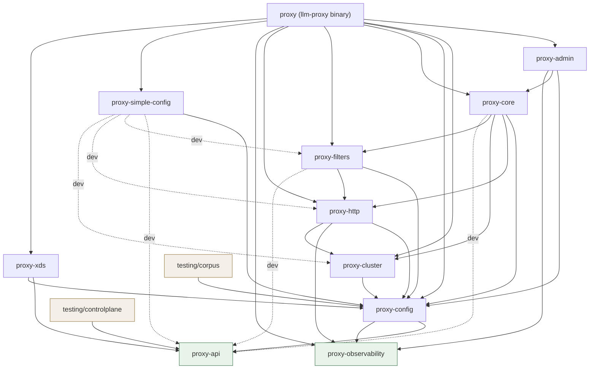

# Workspace dependency graph

> Deliverable for **WP-40 — Dependency-tree review & cleanup**. First acceptance
> criterion: "a documented dependency graph in `docs/`".
>
> **Scope:** workspace-internal edges only (`proxy-*` and the `testing/` crates).
> Third-party dependencies appear only in the candidate-unused table at the end.
>
> **Method:** every `crates/*/Cargo.toml` and `testing/*/Cargo.toml` was read
> directly; usage evidence came from grepping each crate's `src/` and `tests/`.
> `cargo tree`, `cargo metadata`, and `cargo-udeps` were **not** run — see
> [What this document cannot tell you](#what-this-document-cannot-tell-you).

## Why this document exists

Crate-boundary decisions here have twice been forced by an edge rather than by
design:

1. `proxy-cluster` carried an unused `proxy-core` dependency referenced only in
   a doc comment. It caused a real cycle, and it masked that `proxy-cluster` was
   using `rand` purely transitively.
2. The access-log sink hit a genuine cycle constraint — `proxy-config` depends on
   `proxy-observability` and never the reverse — and the first instinct was to
   duplicate an enum across the seam. It resolved correctly by moving
   `AccessLogSink` into `proxy-observability` and re-exporting it from
   `proxy_config::ir`.

Both were discovered at the moment they blocked someone. This is the map that
should have existed first.

## The graph

`testing/diffrig` and `testing/loadgen` have **no** workspace-internal edges by
design: they are black-box rigs that speak to the proxy over the wire.
`testing/qa` is a Go module with zero dependencies — per WP-41 the language
boundary is the point, since a Go module cannot import a Rust crate by accident.

## The layering rule

The graph is a DAG with eight levels. **An edge may only point downward.** An
upward edge is a design error even when Cargo accepts it.

| Level | Crates | Role | May depend on |
|---|---|---|---|
| **L0** | `proxy-api`, `proxy-observability` | Leaves. No internal dependencies, ever. | nothing internal |
| **L1** | `proxy-config` | Protos → IR. Owns the IR. | L0 |
| **L2** | `proxy-cluster`, `proxy-xds`, `proxy-simple-config` | IR consumers/producers off the request path. | L0–L1 |
| **L3** | `proxy-http` | HTTP data plane: codecs, router, filter manager. | L0–L2 |
| **L4** | `proxy-filters` | Concrete filters on L3's `HttpFilter` seam. | L0–L3 |
| **L5** | `proxy-core` | Listeners, workers, TLS, drain. | L0–L4 |
| **L6** | `proxy-admin` | Admin/introspection surface. | L0–L5 |
| **L7** | `proxy` | The binary. Composition root, no library API. | anything |

**Among normal dependencies, no edge contradicts the layering** — every
production edge points strictly downward, there are no cycles, and no pair works
only by accident.

**Among dev-dependencies, three do.** `proxy-simple-config` (L2) dev-depends on
`proxy-filters` (L4), `proxy-http` (L3), and `proxy-cluster` (L2). These are
upward edges existing only in the test build. They are justified, and they are
also the workspace's one real trap.

## Dev-only internal edges

A dev-dependency is invisible to consumers and absent from the production tree,
so it is the easiest place for a layering violation to accumulate unnoticed.

| From | To | Why | Cycle if promoted? |
|---|---|---|---|
| `proxy-core` | `proxy-api` | `#[cfg(test)]` helpers build a real `HeaderValueOption` `DynamicMessage` from the descriptor pool. | No — but promoting it would violate **ground rule #2**. |
| `proxy-filters` | `proxy-api` | Same shape: tests resolve proto descriptors for `typed_config` round-trips. | No; same caveat. |
| `proxy-simple-config` | `proxy-api` | **No usage found anywhere.** See candidate table. | No; same caveat. |
| `proxy-simple-config` | `proxy-filters` | `tests/dialect.rs` pins three filter type-URL constants that `lower.rs` duplicates as literals. | **No today — this is the trap.** |
| `proxy-simple-config` | `proxy-http` | WP-45 acceptance 5: drives a real request through a dialect-lowered config. | No, but inverts L2 → L3. |
| `proxy-simple-config` | `proxy-cluster` | Same end-to-end test needs a real cluster manager. | No, but sideways at L2. |

### The latent trap: `proxy-simple-config` ↔ `proxy-filters`

`MODEL_HEADER` (`"x-llmproxy-model"`) is defined in
`proxy-simple-config/src/lower.rs`. `proxy-filters` needs the same string and
declares its own copy as `MODEL_HEADER_NAME` in `body_rewrite_filter.rs`.
WP-45's design note names this as a cross-crate constant hazard.

The tempting fix is to have `proxy-filters` import it from
`proxy-simple-config`. **Do not.** That produces `proxy-filters →
proxy-simple-config` (normal) alongside `proxy-simple-config → proxy-filters`
(dev, already present). Cargo *permits* exactly that pairing, so it compiles —
and the problem stays invisible until someone needs `proxy-filters` from
`proxy-simple-config`'s own `src/`, at which point it is a hard cycle.

It is also wrong on the merits: `lower.rs` already records that
`proxy-simple-config` is a config crate emitting JSON, and depending on
`proxy-filters` would drag the whole data plane into the dependency tree of
something with no runtime role. That argument runs both ways.

**If the constant must be shared, its home is downward** — `proxy-http` or
`proxy-config`, which both crates already reach. Until then the current
arrangement is correct: duplicate the literal, pin it with a test across the
dev-dependency, and rely on the fact that drift is a loud bind-time error ("no
registered factory for type_url"), never a silent skip. **This only holds while
the `proxy-filters` edge stays dev-only.**

## Who owns which shared type, and why

**A shared type lives in the lowest crate that both consumers can reach.** If
that is lower than either consumer wants, the type is more fundamental than it
looks — that is not a reason to copy it.

| Type | Owner | Why there |
|---|---|---|
| `AccessLogSink` | `proxy-observability` | Needed by `proxy-config` (lowering) and `proxy-http` (writing); the reverse edge can never exist, so it must sit at L0. Re-exported as `proxy_config::ir::AccessLogSink`. **This is the WP-40 precedent.** |
| `ResponseFlag` | `proxy-observability` | Set by the router and filters, rendered by access logs. L0 is the only place all of them see. |
| The IR | `proxy-config` | Ground rule #2 — `proxy-config` is the translation boundary, so it owns the output of that translation. |
| Proto descriptors | `proxy-api` | One crate pins the Envoy API version; generated code and `descriptor_pool()` exist nowhere else. |
| `HttpFilter` and the filter seam | `proxy-http` | The manager owns the contract; `proxy-filters` implements against it. This is why the edge is `filters → http`. |
| `StreamInfo`, `LlmStats` | `proxy-http` | Per-stream bookkeeping, read by the router, filter manager, and access logging. |
| `UpstreamProtocol` | Two owners, deliberately | Config-side and runtime-side enums bridged by one `From`. |
| `Dialect` | Two owners, deliberately | Different domains — see below. |

### Same-shaped types across a crate boundary

WP-40's third acceptance criterion. Four pairs exist; the verdicts are recorded
so they need not be re-litigated.

**1. `LlmTokenUsage` vs `TokenUsage` — a true duplicate, deliberately kept.**
`proxy_http::stream_info::LlmTokenUsage` and `proxy_filters::usage::TokenUsage`
are field-for-field identical (four `u64` buckets, each with a saturating
`total()`). The edge direction forbids the alternative: `proxy-filters` (L4)
depends on `proxy-http` (L3), so `proxy-http` cannot re-export a
`proxy-filters` type. Acceptable but not free — **a fifth token bucket added to
one and not the other is a silent billing bug.** If a third consumer appears,
move the struct down to `proxy-http` rather than adding a third copy.
(There is already effectively a third: `LlmTokens` in `proxy-observability`. See
WP-48's audit.)

**2. `UpstreamProtocol` — not a violation.** Two enums, same name and variants,
in `proxy-config` (IR) and `proxy-cluster` (runtime). This is the ground-rule-#2
seam working: the data plane does not consume config types directly. Exactly one
bridge exists and is documented as the single crossing point.

**3. `Dialect` — not a duplicate.** `proxy_simple_config::model::Dialect` is a
*wire format* a user may write in YAML (two variants).
`proxy_filters::usage::Dialect` is a *parsing strategy* (three), the third
existing because OpenAI's Responses API shares Anthropic's field names with
different semantics. Folding them would be a billing-accuracy bug.

**4. `LimitKey` — a name collision, not a shape duplicate.** One is a config
enum, the other a newtype `String` holding a rendered descriptor key. Worth
knowing when reading a stack trace; not a boundary problem.

## Candidate unused dependencies

**Read this as leads, not deletions.** Evidence is grep over each crate's `src/`
and `tests/` for every form a dependency can appear in. Grep cannot see three
things, and all three produce false positives:

1. **Code generated into `OUT_DIR`.** `proxy-api` uses `prost` and `prost-types`
   pervasively, entirely inside generated code spliced in via `include!`. Both
   show **zero** hits in checked-in source. Deleting them on grep evidence breaks
   the build.
2. Traits used through method syntax without the crate being named.
3. Cargo feature unification.

`cargo-udeps` is the real check and is WP-40's second acceptance criterion.
Nothing below should be removed until it confirms the finding.

| Crate | Dependency | Kind | Verdict | Evidence |
|---|---|---|---|---|
| `proxy-admin` | `proxy-observability` | normal | **likely-unused** | Zero occurrences of `proxy_observability`, `ResponseFlag`, `AccessLogSink`, or `access_log` in `src/` — not even a doc comment, unlike the historical `proxy-cluster → proxy-core` case. Strongest candidate in the workspace. |
| `proxy` | `proxy-xds` | normal | **likely-unused** | `main.rs` is the crate's only file; zero occurrences. |
| `proxy` | `proxy-http` | normal | **likely-unused** | Zero in `main.rs`; reached transitively via `proxy-core`. |
| `proxy` | `proxy-filters` | normal | **likely-unused** | Zero in `main.rs`; reached transitively. |
| `proxy` | `proxy-observability` | normal | **likely-unused** | Zero in `main.rs`. |
| `proxy-xds` | `proxy-api` | normal | **unused today, correct by design** | Doc-comment-only stub for WP-20/21/22. **Keep** — but it will trip any automated unused-dep check until WP-20 lands, so it needs an allowlist entry naming WP-20, in the spirit of WP-39's IR-readership allowlist. |
| `proxy-xds` | `proxy-config` | normal | **unused today, correct by design** | Same stub, same treatment. |
| `proxy-simple-config` | `proxy-api` | **dev** | **likely-unused** | Zero occurrences anywhere in the crate including `tests/`. The only internal `proxy-api` edge with no justifying usage — removing it tightens ground rule #2 at no cost. |
| `proxy-config` | `serde` | normal | **uncertain** | No `use serde`, no derives. The crate uses `serde_json`/`serde_yaml`/`serde_path_to_error`, which depend on `serde` themselves. Plausible feature-unification false positive. |
| `proxy-filters` | `serde` | normal | **uncertain** | Same evidence; only `serde_json` appears. |
| `testing/diffrig` | `http` | normal | **likely-unused** | No `http::` path; the crate uses `hyper` and `http-body-util`. |
| `testing/loadgen` | `futures` | normal | **likely-unused** | No `futures`/`StreamExt`/`join_all`; concurrency is via `tokio` tasks. |
| `proxy-api` | `prost`, `prost-types` | normal | **USED — do not remove** | Zero hits in `src/lib.rs`; used pervasively by generated code. The canonical example of why this table is candidates only. |

## Ground rule #2: proto containment

> Generated protos stay inside `proxy-config` and `proxy-xds`; everything else
> consumes the IR.

**No production violations** — only `proxy-config` and `proxy-xds` carry
`proxy-api` as a normal dependency. Four crates carry it as a dev-dependency,
which Cargo keeps out of the production tree, so the rule holds; each is still
worth knowing about, because a dev edge is one line away from a real one.

| Crate | Status |
|---|---|
| `testing/controlplane` | **Normal**, and correct — it implements an xDS control plane and must speak proto. Outside the data plane by construction. |
| `proxy-core` | Dev only; real usage in `#[cfg(test)]` descriptor-pool helpers. |
| `proxy-filters` | Dev only; real usage in `tests/`. |
| `proxy-simple-config` | Dev only, **no usage found**. Should be removed. |

For anyone reading a `Cargo.toml`: **a `proxy-api` line under `[dependencies]`
in any crate other than `proxy-config` or `proxy-xds` is a finding. Under
`[dev-dependencies]` it is a question that needs an answer in a comment.**

## What this document cannot tell you

- **Whether a dependency is truly unused.** Every candidate row is
  grep-inferred; `cargo-udeps` in CI is the authority and the acceptance
  criterion. The `proxy-api`/`prost` row shows what happens when grep is trusted.
- **Feature-level edges.** Two crates depending on the same third-party crate
  with different features are unified by Cargo. This tracks crate edges only.
- **Transitive weight.** No claim is made about compile-time cost.

## Maintenance

This file is hand-maintained and goes stale the moment someone adds a dependency
line. Two things keep it honest:

1. The layering table is the reviewable artifact — a PR adding an upward edge
   should have to change that table to justify it.
2. `cargo-udeps` in CI (WP-40's second acceptance criterion) catches the
   accumulation this document exists to describe.
